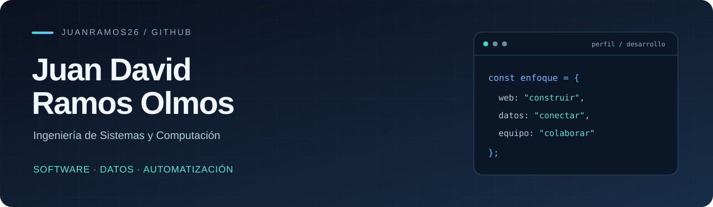

  <strong>Estudiante de Ingeniería de Sistemas y Computación · Universidad Tecnológica de Bolívar</strong> 
  Cartagena, Colombia

  <a href="https://github.com/ISCOUTB/check_u">Proyecto CheckU</a> ·
  <a href="https://github.com/ISCOUTB/check_u/pulls?q=is%3Apr+author%3AJuanRamos26">Mis contribuciones</a>

## Sobre mí

Soy estudiante de noveno semestre de Ingeniería de Sistemas y Computación en la **UTB**. Me interesa construir aplicaciones web que conecten interfaces, servicios y bases de datos para resolver problemas concretos.

Actualmente participo en **CheckU**, un proyecto de grado para apoyar la revisión documental de preinscripciones a grado. Allí trabajo con bases de datos relacionales, integración de un motor OCR y funcionalidades del proceso de preinscripción.

Además de mi formación técnica, tengo experiencia en administración de un negocio: coordinar personas, organizar recursos y atender situaciones del día a día. Esa experiencia influye en cómo trabajo en equipo y entiendo las necesidades de un usuario.

## Tecnologías con las que trabajo

**Desarrollo web y servicios**

**Datos y herramientas**

También cuento con conocimientos académicos en **PHP y C++**, y formación introductoria en **AWS**.

## Proyecto destacado: CheckU

**Revisión documental para preinscripciones a grado, con integración OCR y persistencia de resultados.**

Proyecto colaborativo desarrollado en la UTB. Mis aportes abarcan el diseño de la base de datos relacional y funcionalidades que conectan el formulario, el backend y el análisis documental.

| Aporte | Evidencia |
| --- | --- |
| Diseño de la base de datos relacional | [PR #64](https://github.com/ISCOUTB/check_u/pull/64) |
| Asignación automática del periodo de inscripción | [PR #86](https://github.com/ISCOUTB/check_u/pull/86) |
| Integración del motor OCR y registro de resultados | [PR #88](https://github.com/ISCOUTB/check_u/pull/88) |

[Explorar el repositorio →](https://github.com/ISCOUTB/check_u)

## Formación y próximos pasos

- **Ingeniería de Sistemas y Computación**, en curso en la Universidad Tecnológica de Bolívar.
- **AWS Academy Cloud Foundations**, formación completada en 2025.
- **Bootcamp de Inteligencia Artificial**, UTB, 2026.
- **Inglés B1**.
- Interés en prácticas profesionales durante el **primer semestre de 2027**, especialmente en desarrollo de software, backend y automatización.

---

Me interesa seguir aprendiendo mediante proyectos reales, colaboración y revisión de código.
